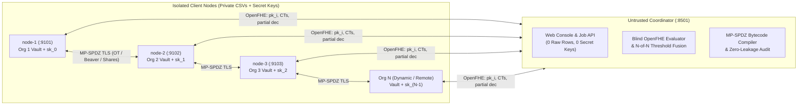

# Private Collaborative Computing — Distributed Multi-Organization System (OpenFHE & MP-SPDZ)

A **domain-agnostic, Dockerized distributed collaborative computing system** that enables **any number of organizations ($N \ge 2$)** to run joint analytics over private CSV datasets without sharing raw records or secret keys with one another or with the central coordinator.

---

## Architecture

- **Isolated Data-Owner Client Nodes (`node-1`, `node-2`, `node-3`, + dynamically added `Organization N`)**:
  - Each node runs its own HTTP/JSON agent (`system/node_agent.py`) with isolated storage (`./volumes/node1`–`./volumes/node3` or `coordinator_data/dynamic_nodes/`).
  - Holds **only its own** raw CSV dataset, **only its own** OpenFHE secret key share (`sk_i`, purged from RAM after decryption), and **only its own** MP-SPDZ `Player-Data/` (`Input-P<i>-0` and private TLS key `P<i>.key`).
- **Untrusted Compute & Orchestration Coordinator (`coordinator`)**:
  - Validates schema alignment using column metadata only (**0 raw CSV rows**, **0 secret keys**).
  - **OpenFHE ($N$-of-$N$ Threshold BFV-RNS)**: Orchestrates collective public/evaluation key generation, evaluates deserialized ciphertexts blindly (`EvalAdd` / `EvalMult`), and fuses $N$ partial decryptions.
  - **MP-SPDZ ($N$-Party TLS)**: Compiles `.mpc` bytecode once and dispatches it to all $N$ nodes, which execute OT / Beaver triples / secret sharing directly across container TLS channels.
  - Records Zero-Leakage Audit digests and job history (`coordinator_data/jobs.json`).



---

## Quick Start

- **Windows (double-click or terminal):** `start.bat` (or `.\start.ps1`) — starts Docker Desktop if needed, launches the cluster, waits for all nodes to come online, and opens `http://localhost:8501`. Stop with `stop.bat`.
- **Linux / macOS / WSL:** `./start.sh` (stop with `./stop.sh`).
- **Docker Compose:**
  ```bash
  docker compose up -d
  ```

### Web Portals
- **Coordinator Console:** `http://localhost:8501`
- **Client Node 1–3 Portals:** `http://localhost:9101`, `http://localhost:9102`, `http://localhost:9103`
- **Dynamic / Remote Node Portals:** `/node-portal/<index>/` on `http://localhost:8501`

---

## Supported Queries & Options

- **Collaborative Queries (any matching-schema CSVs):**
  - `aggregation`: Global `SUM`, `COUNT`, `MEAN`
  - `risk_multiplication`: Weighted Inner Product ($\sum x_i \cdot w_i$)
  - `variance`: Global `Variance` and `Std Dev`
  - `filtered_aggregation`: Privacy-preserving filtered `SUM`, `COUNT`, `MEAN` (hides per-node match counts)
- **Engines:** `OpenFHE` (Threshold BFV), `MP-SPDZ` (3+ / 2+ party TLS), or `Both` (cross-verified).
- **Advanced Options:**
  - **OpenFHE Profiles:** `threshold_bfv_128`, `deep_bfv_128` (`config/fhe.yaml`)
  - **MP-SPDZ Protocols:** `semi_dishonest_majority_3p`, `shamir_honest_majority_3p`, `malicious_shamir_3p`, `mascot_malicious_3p` (`config/smpc.yaml`)
  - **Decimal Scaling:** `auto`, `1`, `10`, `100`
  - **Inter-Container WAN Shaping:** Linux `tc`/`netem` latency & bandwidth profiles (`config/network.yaml`)

---

## CLI & Testing

```bash
# Cluster health & schema alignment
docker compose exec coordinator python3 -m system.cli health

# Add / remove organizations dynamically (auto-provisioned or remote --url)
docker compose exec coordinator python3 -m system.cli add-org --org "Organization 4" --tag "Site-4"
docker compose exec coordinator python3 -m system.cli remove-org --node 4

# End-to-end verification across all active nodes (OpenFHE + MP-SPDZ)
docker compose exec coordinator python3 -m system.cli verify-e2e

# Automated integration test suite
docker compose run --rm test
```

---

## Repository Structure

```text
├── config/                 # FHE, SMPC, and tc/netem network profiles
├── fhe/                    # OpenFHE CryptoContext manager
├── networking/             # Linux tc/netem shaping & /proc/net/dev traffic monitor
├── sample_datasets/        # Neutral sample CSVs for quick testing
├── smpc/                   # MP-SPDZ protocol configuration & binary discovery
├── system/                 # Distributed N-node system (node_agent, coordinator, web_app, cli, UI)
├── tests/                  # Distributed integration test suite
├── Dockerfile              # Ubuntu 24.04 + OpenFHE v1.6.1.0 + MP-SPDZ v0.4.4 + iproute2
├── docker-compose.yml      # 4-container distributed cluster + test service
├── start.bat / stop.bat    # One-click Windows startup & shutdown
└── start.sh / stop.sh      # Linux / macOS / WSL startup & shutdown
```
