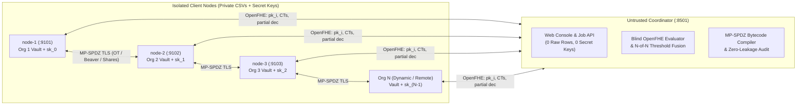
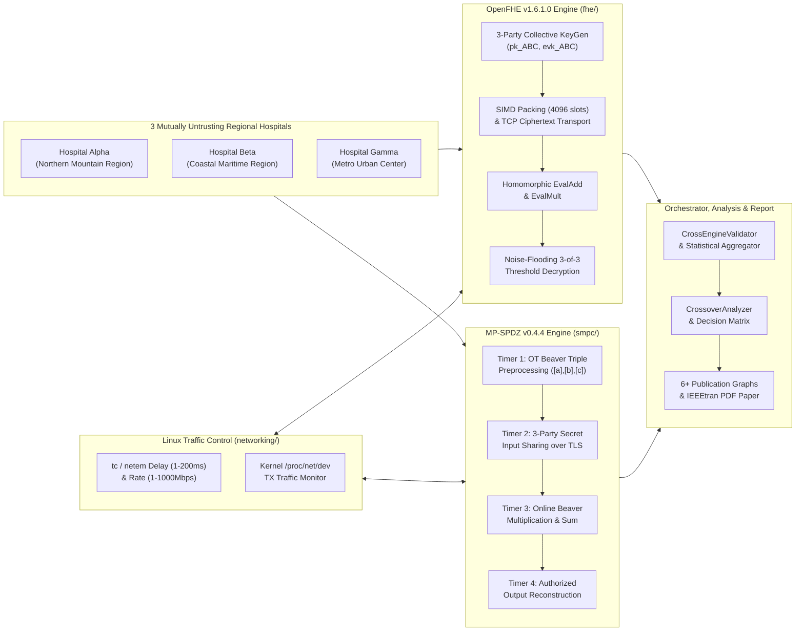

# Private Collaborative Computing — Distributed System & FHE vs. SMPC Evaluation

## 0. Distributed Multi-Organization System (`system/`)

This repository provides a **domain-agnostic, multi-container distributed collaborative computing system** supporting **any number of organizations ($N \ge 2$)** alongside the academic benchmarking suite below:

- **Isolated Data-Owner Client Nodes (`node-1`, `node-2`, `node-3`, + dynamically added `Organization N`)**: Each organization runs in its own isolated vault (`./volumes/node1`–`./volumes/node3` or `coordinator_data/dynamic_nodes/`), holds **only its own** private CSV dataset, generates and retains **only its own** OpenFHE secret key share (`sk_i`, purged post-decryption), and executes **only its own** MP-SPDZ TLS party (`P0..P(N-1)`).
- **Untrusted Compute & Orchestration Coordinator (`coordinator`)**: Orchestrates jobs over `pcc_mesh` without ever seeing raw CSV rows or secret keys. Validates schema alignment via column metadata only, executes blind OpenFHE evaluation (`EvalAdd` / `EvalMult`) on deserialized ciphertexts or dispatches compiled `.mpc` bytecode to all $N$ nodes, and records Zero-Leakage Audit digests.



### One-Click / One-Command Startup
- **Windows (double-click or terminal):** `start.bat` (or `.\start.ps1`) — starts Docker Desktop if needed, launches the 4-container cluster (`node-1`, `node-2`, `node-3`, `coordinator`), waits for all nodes to come online, and opens `http://localhost:8501`. Stop anytime with `stop.bat`.
- **Linux / macOS / WSL:** `./start.sh` (stop with `./stop.sh`).
- **Docker Compose directly:**
  ```bash
  docker compose up -d
  # Or: make up
  ```

### Web Portals & CLI
- **Coordinator Console:** `http://localhost:8501` (manage organizations via **+ Add Organization**, run queries, inspect **Audit Proof** & **History**)
- **Standalone Client Node Portals:** `http://localhost:9101`, `http://localhost:9102`, `http://localhost:9103` (and `/node-portal/<index>/` on `:8501` for any dynamically added or remote organization)
- **CLI Commands:**
  ```bash
  # Check cluster health & schema alignment
  docker compose exec coordinator python3 -m system.cli health

  # Add / remove organizations dynamically (auto-provisioned or remote --url)
  docker compose exec coordinator python3 -m system.cli add-org --org "Organization 4" --tag "Site-4"
  docker compose exec coordinator python3 -m system.cli remove-org --node 4

  # Verify all 4 workloads end-to-end across all active nodes (OpenFHE + MP-SPDZ)
  docker compose exec coordinator python3 -m system.cli verify-e2e

  # Run a specific query with optional inter-container tc/netem WAN shaping
  docker compose exec coordinator python3 -m system.cli run \
    --engine both --workload aggregation --value-col primary_metric \
    --apply-network --latency moderate_wan --bandwidth restricted
  ```

### Supported Queries & Cryptographic Options
- **Queries (any matching-schema CSVs):**
  - `aggregation`: Global `SUM`, `COUNT`, `MEAN`
  - `risk_multiplication`: Weighted Inner Product ($\sum x_i \cdot w_i$)
  - `variance`: Global `Variance` and `Std Dev`
  - `filtered_aggregation`: Privacy-preserving filtered `SUM`, `COUNT`, `MEAN` (hides per-node match counts)
- **Engines & Advanced Options:**
  - **OpenFHE Profiles:** `threshold_bfv_128` (`FIXED_NOISE_MULTIPARTY`), `deep_bfv_128` (`NOISE_FLOODING_MULTIPARTY`)
  - **MP-SPDZ Protocols:** `semi_dishonest_majority_3p`, `shamir_honest_majority_3p`, `malicious_shamir_3p`, `mascot_malicious_3p`
  - **Decimal Scaling:** `auto`, `1`, `10`, `100` (with BFV plaintext-modulus overflow guard)
  - **Inter-Container WAN Emulation:** Linux `tc`/`netem` latency & bandwidth shaping across containers
- **Automated Test Suite (28 tests):** `docker compose run --rm test`

---

## 1. Project Introduction

This repository contains a complete, reproducible, Dockerized academic research and benchmarking framework comparing **Fully Homomorphic Encryption (FHE)** via **OpenFHE v1.6.1.0** against **Secure Multi-Party Computation (SMPC)** via **MP-SPDZ v0.4.4** across three simulated regional hospitals studying a novel disease (**Hospital Alpha: Northern Mountain Region**, **Hospital Beta: Coastal Maritime Region**, and **Hospital Gamma: Metro Urban Center**).

Because multi-region clinical cohorts have distinct regional baselines and cannot be pooled centrally due to patient privacy regulations (HIPAA/GDPR), both cryptographic engines execute identical collaborative clinical analytics workloads over deterministic, regionally diverse patient cohorts (or per-hospital CSV files) under Linux kernel traffic-controlled (`tc` / `netem`) network latency and bandwidth conditions. The orchestrator automatically detects performance crossover thresholds, generates publication-grade graphs (PNG & vector PDF), and compiles an IEEEtran LaTeX research paper.

---

## 2. Research Objectives

The framework experimentally investigates the operational trade-offs and crossover boundaries across:
- **FHE Ciphertext Expansion & SIMD Batching**: RLWE polynomial ring representation ($n = 8,192\text{--}16,384, p = 536,903,681$) with 4096-slot SIMD packing, collective 3-hospital key generation, tensor-product relinearization, and 3-of-3 threshold decryption.
- **FHE Noise Growth & Bootstrapping**: RNS modulus budget consumption across homomorphic addition and multiplication, plus an isolated CKKS bootstrapping overhead study (`bootstrapping_ckks_exp`).
- **SMPC Secret Sharing & Beaver Multiplication Triples**: 3-party additive and Shamir secret sharing over a 128-bit prime field $\mathbb{F}_p$, Oblivious Transfer (OT) Beaver triple preprocessing $([a],[b],[c])$, and interactive online Beaver multiplication ($[x \cdot w] = [c] + d[b] + e[a] + de$).
- **Orthogonal Scaling Dimensions**:
  - **Cohort Size ($N$ patients)**: `100` (*Small*), `1,000` (*Medium*), `10,000` (*Large*), `50,000` (*Very Large*), and `100,000` (*Stress Test*).
  - **Network Latency ($L$)**: `1 ms` (*Local*), `10 ms` (*Fast WAN*), `50 ms` (*Moderate WAN*), `100 ms` (*Slow WAN*), and `200 ms` (*High Latency*).
  - **Network Bandwidth ($B$)**: `1 Gbps` (*High*), `100 Mbps` (*Medium*), `10 Mbps` (*Restricted*), and `1 Mbps` (*Very Restricted*).

---

## 3. Architecture Overview



---

## 4. Technologies and Pinned Dependencies

| Component | Technology / Version | Purpose |
|---|---|---|
| **Base OS** | Ubuntu 24.04 LTS (`noble`) | Linux kernel `tc`/`netem` & glibc compatibility |
| **FHE Backend** | `openfhe==1.6.1.0.24.4` | Official OpenFHE C++ library with Python 3.12 bindings |
| **SMPC Backend** | `MP-SPDZ v0.4.4` | 3-party secret-sharing & Beaver triple virtual machines (`semi-party.x`, `shamir-party.x`, `malicious-shamir-party.x`, `mascot-party.x`) |
| **Network Shaping** | `iproute2` (`tc`, `netem`, `ip`) | Kernel-level latency, jitter, packet loss, and bandwidth shaping |
| **Data & Stats** | `numpy==1.26.4`, `pandas==2.2.2`, `scipy==1.13.1` | Seeded dataset generation, Welch's $t$-tests, Mann-Whitney $U$ tests, Monte Carlo crossover CIs |
| **Visualization** | `matplotlib==3.9.0`, `seaborn==0.13.2` | High-resolution 300 DPI PNG and vector PDF academic graphs |
| **Paper Compilation** | TeXLive (`pdflatex`, `texlive-publishers` / `IEEEtran`) | Automated 5–6 page IEEE conference paper compilation |
| **Testing** | `pytest==8.2.2` | Automated correctness, security, and pipeline regression suite |

---

## 5. Docker Setup and One-Command Execution

### Primary Orchestration Command (Standard Research Suite)
Builds the complete Ubuntu 24.04 image with OpenFHE, MP-SPDZ, `tc`/`netem`, and TeXLive, executes the multi-repetition benchmark matrix, performs statistical crossover analysis, generates all graphs, and compiles the IEEE PDF report:

```bash
docker compose run --build --rm benchmark
```

### Quick Mode (Rapid Verification Matrix)
Executes the benchmark matrix across Small ($100$), Medium ($1,000$), and Large ($10,000$) datasets and all network profiles with 5 repetitions:

```bash
docker compose run --build --rm benchmark-quick
```

### Full Stress-Test Mode
Executes the complete matrix up to $N = 100,000$ transactions with 2 warm-up runs and 5 measured repetitions:

```bash
PCC_EXPERIMENT_MODE=full docker compose run --build --rm benchmark
```

### Required Container Privileges
Network emulation via Linux `tc` and `netem` requires only the `CAP_NET_ADMIN` capability (`cap_add: [NET_ADMIN]` in `docker-compose.yml`). Full `privileged: true` containers are **not** used, ensuring host network interfaces remain isolated and unmodified.

---

## 6. Running Individual Pipelines and Components

### 1. Run Automated Test Suite (`pytest`)
```bash
docker compose run --rm test
```

### 2. Run FHE Pipeline Standalone
```bash
docker compose run --rm fhe
```

### 3. Run SMPC Pipeline Standalone
```bash
docker compose run --rm smpc
```

### 4. Run Crossover Analysis, Graph Generation, and IEEE Paper Compilation
```bash
docker compose run --rm analysis
```

### 5. Interactive Demonstration (CLI & Web GUI)
For live presentations or interactive testing across the 3 hospitals:
- **Interactive CLI Demo:**
  ```bash
  docker compose run --rm demo
  # Or non-interactive with flags:
  docker compose run --rm demo python3 -m demo.cli --size medium --workload risk_multiplication --latency moderate_wan --bandwidth restricted
  ```
- **Web GUI Dashboard (`http://localhost:8501`):**
  ```bash
  docker compose up gui
  ```

### 6. Generate Region-Diverse Hospital Cohorts Programmatically
```bash
docker compose run --rm benchmark python3 -c "
from dataset import DatasetGenerator, DatasetValidator
gen = DatasetGenerator()
for prof in ['small', 'medium', 'large', 'very_large', 'stress_test']:
    ds = gen.generate(prof, seed=42, materialize_records=(prof in ['small', 'medium']))
    DatasetValidator.validate_dataset(ds, plaintext_modulus=536903681)
    print(prof, 'N=', ds.total_patients, 'Ref=', ds.reference.to_dict())
"
```

---

## 7. Configuration Instructions

All experimental parameters are externalized in `config/`:
- `config/experiment.yaml`: Random seed (`42`), 3 regional hospital metadata, clinical biomarker/severity bounds, cohort size profiles (`100` to `100,000`), workload definitions (`aggregation`, `risk_multiplication`), warm-up counts, and measured repetitions (`5`).
- `config/fhe.yaml`: OpenFHE cryptographic parameter profiles (`threshold_bfv_128`, `single_key_bfv_128`, `deep_bfv_128`, `bootstrapping_ckks_exp`), ring dimensions, plaintext modulus ($536903681$), multiplicative depth, and SIMD batch size ($4096$).
- `config/smpc.yaml`: MP-SPDZ protocol specifications (`semi_dishonest_majority_3p`, `shamir_honest_majority_3p`, `malicious_shamir_3p`, `mascot_malicious_3p`), prime-field bit lengths, and strict Beaver triple non-reuse policy (`allow_triple_reuse: false`).
- `config/network.yaml`: Linux `tc`/`netem` latency profiles (`1 ms` to `200 ms`), bandwidth profiles (`1 Gbps` down to `1 Mbps`), packet loss percentage, and live RTT probe settings.

---

## 8. Output Artifacts and Directory Structure

All experimental outputs are persisted to `./results/`:
- `results/raw/raw_benchmarks.csv` & `raw_benchmarks.json`: Every individual trial measurement (including warm-up and measured repetitions) with full cryptographic and network metadata.
- `results/processed/summary_benchmarks.csv` & `summary_benchmarks.json`: Mean, median, standard deviation, min, max, and 95% Student-$t$ confidence intervals per configuration.
- `results/processed/pairwise_statistical_comparison.csv`: Welch's $t$-test, Mann-Whitney $U$ test, $\Delta T$, and speedup factors for every FHE vs. SMPC condition.
- `results/processed/crossover_thresholds.csv` & `crossover_analysis.json`: Measured bracketing intervals and piecewise-linearly interpolated crossover thresholds with 95% Monte Carlo uncertainty bounds.
- `results/processed/decision_matrix.csv`: Experimentally derived decision recommendations with empirical evidence.
- `results/graphs/`:
  - `graph1_execution_time_vs_dataset_size.{png,pdf}`
  - `graph2_network_traffic_vs_latency.{png,pdf}`
  - `graph3_execution_time_vs_latency.{png,pdf}`
  - `graph4_execution_time_vs_bandwidth.{png,pdf}`
  - `graph5_storage_expansion_comparison.{png,pdf}`
  - `graph6_computation_phase_breakdown.{png,pdf}`
- `results/reports/`:
  - `ieee_research_report.tex`: Populated IEEEtran LaTeX source.
  - `ieee_research_report.pdf`: Compiled 5–6 page IEEE conference paper.

---

## 9. Troubleshooting and Security Limitations

- **`RTNETLINK answers: Operation not permitted` when running `tc`**: Ensure the container is started via `docker compose` (which includes `cap_add: [NET_ADMIN]`) or pass `--cap-add=NET_ADMIN` to `docker run`.
- **MP-SPDZ SSL Certificate Errors**: If `Player-Data/` is mounted empty, `SMPCParticipantManager.ensure_ssl_certificates()` automatically invokes `/opt/mp-spdz/Scripts/setup-ssl.sh 3` to generate self-signed TLS certificates (`P0.pem`–`P2.pem`).
- **Security Limitations**: See [`docs/limitations.md`](docs/limitations.md) for a detailed discussion of passive vs. active malicious security models, N-out-of-N threshold availability, and shared-interface network emulation boundaries.
