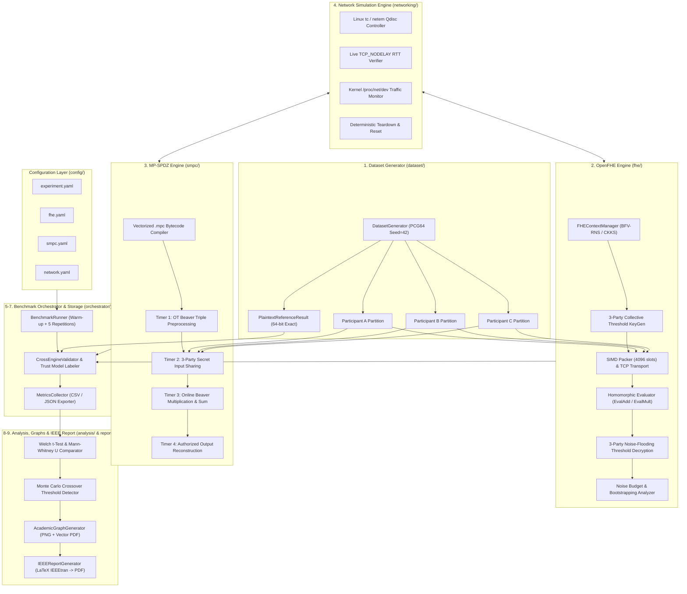

# System Architecture: Private Collaborative Computing (FHE vs. SMPC)

## 1. Architectural Overview

The system models three mutually untrusting financial institutions (**Participant A: Retail Banking**, **Participant B: Commercial Treasury**, and **Participant C: Cross-Border Settlement**) that want to jointly evaluate aggregate financial analytics and multiplicative risk exposure over their private transaction partitions without disclosing raw datasets to one another or to an external third party.

The architecture strictly decouples the **OpenFHE Engine** and the **MP-SPDZ SMPC Engine** behind a unified **Benchmark Orchestrator**, **Network Simulation Engine**, and **Statistical Crossover Analysis Pipeline**.

---

## 2. Execution Flow

1. **Configuration & Schedule Construction (`orchestrator/experiment_manager.py`)**:
   Loads `config/experiment.yaml`, `config/fhe.yaml`, `config/smpc.yaml`, and `config/network.yaml`, generating a deduplicated schedule across dataset sizes ($N \in [100, 100000]$), latency tiers ($1\text{ ms}$ to $200\text{ ms}$), bandwidth caps ($1\text{ Gbps}$ down to $1\text{ Mbps}$), and computational workloads (`aggregation` and `risk_multiplication`).
2. **Deterministic Dataset Partitioning (`dataset/generator.py`)**:
   Uses a seeded NumPy PCG64 generator (`seed: 42`) to synthesize $N$ financial transactions, partitions them disjointly across `participant_a`, `participant_b`, and `participant_c`, and computes exact 64-bit integer reference values.
3. **Kernel Network Shaping & RTT Verification (`networking/network_emulator.py`)**:
   Applies `tc qdisc replace dev <iface> root netem delay <D>ms rate <R>mbit limit 
`, verifies qdisc activation, and measures live application-level TCP round-trip time prior to running benchmarks.
4. **OpenFHE Execution (`fhe/benchmark.py`)**:
   Initializes the BFV-RNS context ($p = 536903681, n = 16384$), runs 3-party interactive collective public key and evaluation key generation, packs each party's records into 4096-slot SIMD plaintexts, encrypts and transmits serialized ciphertexts over TCP sockets, executes `EvalAdd` and `EvalMult`, and performs 3-party distributed partial decryption with noise flooding (`MultipartyDecryptLead`, `MultipartyDecryptMain`, `MultipartyDecryptFusion`).
5. **MP-SPDZ Execution (`smpc/benchmark.py`)**:
   Purges any prior preprocessing files (preventing Beaver triple reuse), writes private participant inputs to `Player-Data/Input-P{0,1,2}-0`, compiles the vectorized `.mpc` program, and spawns three concurrent MP-SPDZ virtual machine processes (`P0`, `P1`, `P2`) over TLS sockets with four phase timers.
6. **Cross-Engine Validation & Statistical Persistence (`orchestrator/validation.py`, `orchestrator/metrics_collector.py`)**:
   Verifies that FHE, SMPC, and the plaintext reference agree identically, labels trust-assumption equivalence, and exports raw and aggregated statistics to `results/raw/` and `results/processed/`.
7. **Automated Crossover Analysis, Graphing, and Report Compilation (`analysis/`, `reports/`)**:
   Detects measured and interpolated crossover thresholds with 95% confidence bounds, generates all publication charts in PNG and PDF formats, and compiles the 5–6 page IEEE research paper via `pdflatex`.
